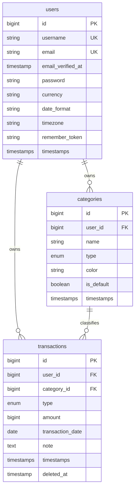

# SCHEMA.md — Daily Ledger database

## 1. "Where is the database?" (answering your question)

You didn't choose a database, but Laravel did it for you. Since Laravel 11, a fresh project defaults to **SQLite**: the whole database is **one file** inside your project, and the migrations created the tables when the agent ran `php artisan migrate`. Your CRUD data is not hardcoded — it is real rows in that file. That's why it survived page reloads.

I can't see your project, so verify these on your machine rather than trusting me:

### 1.1 Find out what you're actually using

Open `.env` in the project root and look for:

```
DB_CONNECTION=sqlite
# DB_DATABASE=...        (if missing/commented, Laravel uses database/database.sqlite)
```

or from a terminal in the project folder:

```bash
php artisan about              # shows the active database driver
php artisan db:show            # driver, database name, tables, sizes
php artisan db:table users     # columns of one table
```

- `DB_CONNECTION=sqlite` → the file is `database/database.sqlite`.
- `mysql` / `mariadb` / `pgsql` → the data lives in a server; `DB_HOST`, `DB_DATABASE`, `DB_USERNAME`, `DB_PASSWORD` in `.env` tell you where and how to connect (often XAMPP/Laragon/Docker).

### 1.2 Ways to look inside (pick one)

| Method | How | Good for |
|--------|-----|----------|
| **Tinker** (no extra install) | `php artisan tinker` then `User::all();`, `Transaction::latest()->take(5)->get();`, `DB::table('transactions')->count();` | Quick checks |
| **DB Browser for SQLite** (free GUI) | Install, *Open Database* → `database/database.sqlite` | Browsing and editing rows visually |
| **VS Code extension** (SQLite Viewer / SQLite) | Right-click `database.sqlite` → open | Staying in the editor |
| **TablePlus / DBeaver / DataGrip** | New connection → SQLite → pick the file (or MySQL/Postgres creds from `.env`) | A nicer long-term tool |
| **`php artisan db`** | Opens the DB's CLI (needs the `sqlite3` binary installed) | Raw SQL |

Close the GUI before running migrations, since SQLite locks the file while it is open for writing.

### 1.3 Are passwords encrypted?

They're **hashed** (one-way, bcrypt by default), not stored in plain text and not decryptable. Check it yourself:

```bash
php artisan tinker
>>> User::first()->password
```

You should see something like `$2y$12$...` (60 chars). If you see readable text, tell me — that would be a real bug. The `users` table also has `email`, and the registration confirmation depends on the mail setup (see LOGIC.md §2.3).

### 1.4 Other tables you didn't ask for but will see

`migrations`, `sessions` (logged-in sessions are stored in the DB by default), `cache`, `cache_locks`, `jobs`, `job_batches`, `failed_jobs`, `password_reset_tokens`. These are Laravel's own.

### 1.5 Safety

- Add `database/*.sqlite` to `.gitignore` (Laravel does by default — confirm) so user data and your test accounts never go to GitHub.
- **Back up** by copying `database.sqlite` while the app is idle.
- `php artisan migrate:fresh --seed` **wipes everything**. Never run it on data you care about.

---

## 2. Entity relationship



---

## 3. Tables

### 3.1 `users`
| Column | Type | Notes |
|--------|------|-------|
| id | bigint PK | |
| username | string(30), **unique** | no `@`; store as typed, compare case-insensitively (or store lowercase in `username_normalized`) |
| email | string, **unique** | store lowercase |
| email_verified_at | timestamp, null | null = unverified |
| password | string | hashed |
| currency | string(3), default `IDR` | display only |
| date_format | string, default `d/m/Y` | PHP date format |
| timezone | string, default `Asia/Jakarta` | used for "today" |
| remember_token | string(100), null | |
| created_at / updated_at | timestamps | |

Replace the default `name` column with `username` (or keep `name` as display name and add `username`).

### 3.2 `categories`
| Column | Type | Notes |
|--------|------|-------|
| id | bigint PK | |
| user_id | FK → users, `cascadeOnDelete` | |
| name | string(40) | |
| type | enum(`expense`,`income`) | |
| color | string(7) | hex, e.g. orange accent used by Food & Dining |
| is_default | boolean, default false | seeded ones; "Other" is protected |
| timestamps | | |

Constraints: **unique (user_id, type, name)**. Index on `user_id`.

### 3.3 `transactions`
| Column | Type | Notes |
|--------|------|-------|
| id | bigint PK | |
| user_id | FK → users, `cascadeOnDelete` | |
| category_id | FK → categories, **`restrictOnDelete`** | block deleting a category in use |
| type | enum(`expense`,`income`) | must equal the category's type (validate in code) |
| amount | **unsigned bigint** | whole IDR; never float/decimal-as-float |
| transaction_date | **date** | no time part, avoids timezone drift |
| note | text, null | |
| created_at / updated_at | timestamps | |
| deleted_at | timestamp, null | soft delete (optional) |

Indexes:
- `(user_id, transaction_date)` — dashboard, history, statistics
- `(user_id, category_id)` — category totals
- `(user_id, type, transaction_date)` — income vs expense reports

Why `amount` is an integer: IDR has no minor unit in practice. If you later support USD/EUR, either store **minor units** (cents) with a `currency` column per transaction, or keep the app single-currency-per-user and never convert (decision D2 in LOGIC.md).

---

## 4. Migration sketch

```php
Schema::table('users', function (Blueprint $t) {
    $t->string('username', 30)->unique()->after('id');
    $t->string('currency', 3)->default('IDR');
    $t->string('date_format', 20)->default('d/m/Y');
    $t->string('timezone', 64)->default('Asia/Jakarta');
});

Schema::create('categories', function (Blueprint $t) {
    $t->id();
    $t->foreignId('user_id')->constrained()->cascadeOnDelete();
    $t->string('name', 40);
    $t->enum('type', ['expense', 'income']);
    $t->string('color', 7)->default('#E8A27A');
    $t->boolean('is_default')->default(false);
    $t->timestamps();
    $t->unique(['user_id', 'type', 'name']);
});

Schema::create('transactions', function (Blueprint $t) {
    $t->id();
    $t->foreignId('user_id')->constrained()->cascadeOnDelete();
    $t->foreignId('category_id')->constrained()->restrictOnDelete();
    $t->enum('type', ['expense', 'income']);
    $t->unsignedBigInteger('amount');
    $t->date('transaction_date');
    $t->text('note')->nullable();
    $t->timestamps();
    $t->softDeletes();
    $t->index(['user_id', 'transaction_date']);
    $t->index(['user_id', 'category_id']);
    $t->index(['user_id', 'type', 'transaction_date']);
});
```

**Check first:** your current migrations were written by the agent and probably differ (e.g. a `date` stored as datetime, `amount` as decimal/float, no `user_id` on transactions, no `type`). Compare with `php artisan db:table transactions`. If real data isn't precious, `migrate:fresh` after fixing the migrations is the cleanest route. If it is, write a new migration that alters the tables instead of editing old ones.

---

## 5. Model rules

- `User`: `hasMany(Category)`, `hasMany(Transaction)`; casts `'password' => 'hashed'`, `'email_verified_at' => 'datetime'`; implements `MustVerifyEmail`.
- `Category`: `belongsTo(User)`, `hasMany(Transaction)`; `$fillable = ['name','type','color']` (never `user_id`, set it in code).
- `Transaction`: `belongsTo(User)`, `belongsTo(Category)`; `$fillable = ['category_id','type','amount','transaction_date','note']`; casts `'transaction_date' => 'date'`, `'amount' => 'integer'`; `SoftDeletes`.
- Global/local scope `forUser($user)` and use it everywhere.

---

## 6. Key queries

```php
// Spent today
Transaction::forUser($u)->where('type','expense')
    ->whereDate('transaction_date', now($u->timezone)->toDateString())->sum('amount');

// This month
Transaction::forUser($u)->where('type','expense')
    ->whereBetween('transaction_date', [$monthStart, $monthEnd])->sum('amount');

// Category totals
Transaction::forUser($u)->where('type','expense')
    ->whereBetween('transaction_date', [$from, $to])
    ->selectRaw('category_id, SUM(amount) total, COUNT(*) cnt')
    ->groupBy('category_id')->orderByDesc('total')->get();

// Daily spending
Transaction::forUser($u)->where('type','expense')
    ->whereBetween('transaction_date', [$from, $to])
    ->selectRaw('transaction_date d, SUM(amount) total')->groupBy('d')->orderBy('d')->get();

// Balance
$income  = Transaction::forUser($u)->where('type','income')->sum('amount');
$expense = Transaction::forUser($u)->where('type','expense')->sum('amount');
$balance = $income - $expense;
```

---

## 7. Seeders

- `DefaultCategorySeeder` / `User::created` hook: when a user registers, insert the default categories (LOGIC.md §4) with `is_default = true`.
- `DemoSeeder` (local only): a test user + ~30 transactions across the month, so Statistics and Dashboard have something to show. The screenshots currently show a single "Kopi" entry, which hides layout and chart problems.
- Factories for `Transaction` and `Category` to support feature tests.

---

## 8. Things the schema does **not** cover yet (future)

Budgets (monthly limit per category), recurring transactions, multiple accounts/wallets (cash, bank, e-wallet — a likely next request once "total balance" exists), attachments (receipt photos), tags, audit log. Add them as new tables later; none of the above requires changing the three tables here except `account_id` on transactions for wallets.
